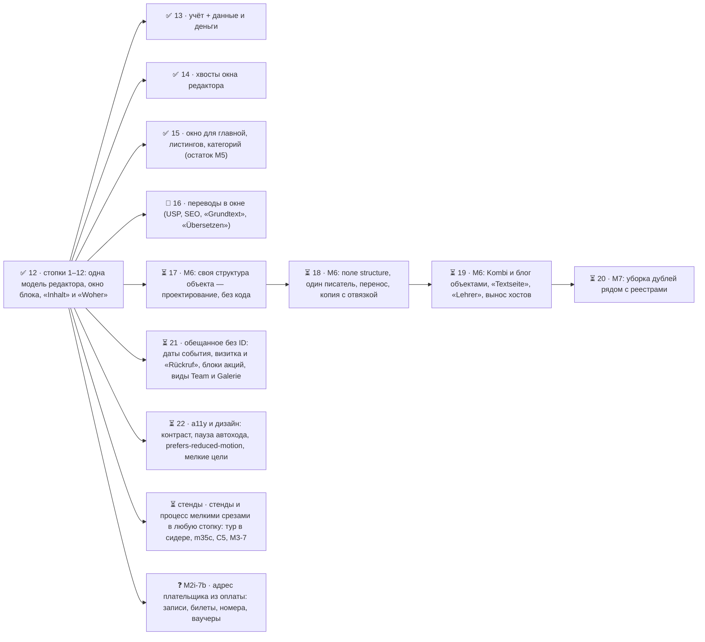

# Карта работ FB-33 — порядок, статус и зависимости стопок

**Единственное место, где записаны порядок и статус стопок.** Передачи, планы и `CLAUDE.md` на карту
ссылаются, а не повторяют её (T-14.1: порядок в двух документах одного дня разошёлся). Что входит в
стопку подробно, известные ошибки и ТЗ сессии — `docs/fb33-handoff-2026-11-24.md`; что осталось по
плану и roadmap — `docs/fb33-remaining-plan-2026-11-24.md`; ID срезов — `docs/task-catalog.md`.

Правила:
- Порядок строк — предлагаемый порядок работ; состав каждой стопки утверждает владелец.
- Статус — один из: `в main` · `в работе` · `дальше` · `ждёт решения` · `отменено`. В работе — одна стопка.
- Стопку нельзя взять, пока её зависимости не `в main`. Что можно брать сейчас —
  `uv run python scripts/work_map.py`.
- Начало стопки: `uv run python scripts/work_map.py --set <N> "в работе"`; ID её срезов к этому
  моменту заведены в `task-catalog.md` (метки будущих стопок — D1, E3, T2… — рабочие).
- Конец стопки: `uv run python scripts/stack_close.py --stack <N>` (снимок, журнал, build-log,
  `docs/wip/`, ветка в `main`), затем `--set <N> "в main"`.
- Меняется состав или порядок — правится строка здесь, тем же коммитом, что и план.
- Замок — `apps/core/tests/test_work_map.py`; граф ниже пересобирает `work_map.py --graph`.

| Стопка | Статус | Зависит от | Срезы | Что | До кода нужно |
|---|---|---|---|---|---|
| 12 | в main | — | M0…M5d-5 | стопки 1–12: одна модель редактора, окно блока, «Inhalt» и «Woher» | — |
| 13 | в main | 12 | M7-0, D1, D2, D3, D4a, D4b, D5, D6, D7, D8 | учёт + данные и деньги | решение D6; план с `sa-deals-money` |
| 14 | в main | 12 | E1, E2, E3, E4, E5, E6, E7, E8, E9, M5d-6, M5d-8 | хвосты окна редактора | макет для E7; `sa-cabinet-screen` для E6 |
| 15 | в main | 12 | M5e-0, K0, M5e-1a, M5e-1b, M5e-2a, M5e-2b, M5e-3, M1d, E1t, E8c | окно для главной, листингов, категорий (остаток M5) | инвентарь, макеты, решения |
| 16 | в работе | 12 | T1, T2, T3, T4, T5, T6, D9, E10, K1 | переводы в окне (USP, SEO, «Grundtext», «Übersetzen») | решения T2 и T5 |
| 17 | дальше | 12 | M6-0 | M6: своя структура объекта — проектирование, без кода | — |
| 18 | дальше | 17 | M6a, M6b, M6c | M6: поле `structure`, один писатель, перенос, копия с отвязкой | план M6, решения владельца; миграции |
| 19 | дальше | 18 | M6d, M6e, M6f, M6g | M6: Kombi и блог объектами, «Textseite», «Lehrer», вынос хостов | M6a–c в main и деплой; миграции |
| 20 | дальше | 19 | M7 | M7: уборка дублей рядом с реестрами | прогон `form_i18n_realign` на сервере до 2026-12-15 |
| 21 | дальше | 12 | P2-4, P2-5, M0-9 | обещанное без ID: даты события, визитка и «Rückruf», блоки акций, виды Team и Galerie | макет на каждый пункт, решения |
| 22 | дальше | 12 | — | a11y и дизайн: контраст, пауза автохода, `prefers-reduced-motion`, мелкие цели | варианты дизайна на холсте |
| стенды | дальше | 12 | — | стенды и процесс мелкими срезами в любую стопку: тур в сидере, m35c, C5, M3-7 | — |
| M2i-7b | ждёт решения | 12 | M2i-7b | адрес плательщика из оплаты: записи, билеты, номера, ваучеры | решение владельца; план с `sa-deals-money` |

<!-- граф: начало -->

<!-- граф: конец -->
